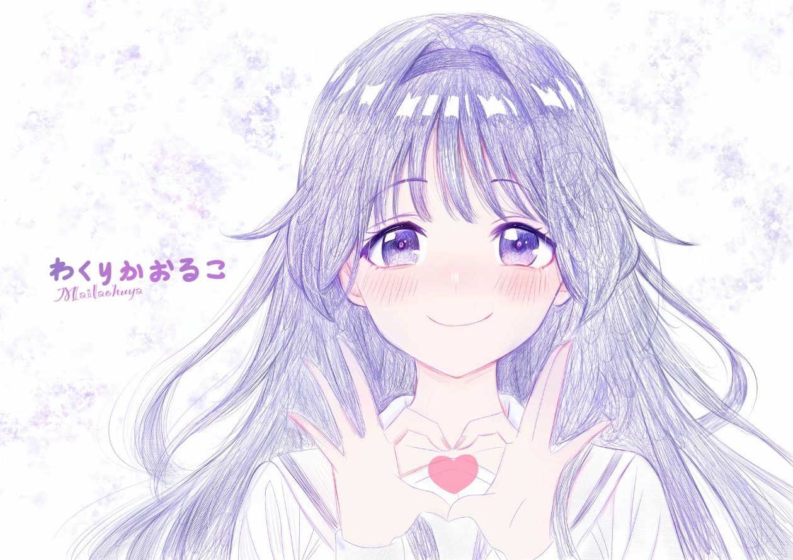

<div align="center">

# 🌸 dsh-startup-animation

**A startup animation + home-screen wallpaper for DeepSeek Harness**

*Those two seconds while the app opens can look lovely too — meow.*



</div>

**[简体中文](README.md)** | **[English](README.en.md)** | **[日本語](README.ja.md)** | **[한국어](README.ko.md)**

---

## ✨ What it does

One launch, one little show 🎬

| Moment | Screen |
| --- | --- |
| `0.0s` | The home screen is hidden ahead of time by an early script in `<head>`, so **the white home screen never flashes first** |
| `~0.1s` | The background eases in · auroras drift back and forth · stardust twinkles · light motes float up · a shooting star occasionally streaks past |
| `~0.2s` | The avatar bounces in with a pop, wrapped in a flash ring + sparks bursting out around it + two ripples, while a glassy reflection sweeps across |
| `~0.3s` | "**Welcome back**" floats up one character at a time, and a thin gradient line unfolds below |
| Throughout | Two loading rings turn slowly in opposite directions · the avatar pushes in very slowly · move the mouse and the whole screen shifts with **layered parallax** by depth, while the avatar tilts gently in 3D and a warm light follows the pointer 🐾 |
| When loaded | The camera "catches" the background: it settles from the pushed-in state back to 1:1 (you can see that beat), and the whole splash layer fades out; **the home-screen modules snap together one by one** 🧩 |
| Once inside | The home-screen wallpaper **is the same background image**, so the handoff looks like the background going from soft to sharp — nice and seamless 🍃 |

The shortest show is 1.5 seconds, and it blocks you for at most 5 seconds; **click once or press any key** to skip.

That whole show has **three tiers** (Battery Saver / Standard / Gorgeous, Standard by default), plus **seasonal easter eggs that change with the date** (cherry-blossom season, snowfall, New Year, birthday) — all adjustable in settings; see "Quality tiers" and "Seasonal easter eggs" below.

There's one more change after you reach the home screen: the title row of a new session **drops the whale logo on the left and the "Preview" badge on the right**, then replaces "Explore the unknown" with a greeting of your own, **typed out one character at a time**, with a blinking text cursor at the end — as if someone is talking to you (the default is "Hello, I'm Kaoruko Wakuri. Welcome to Deepseek Harness.").

The wording, speed, cursor, and the two hide toggles **are all editable in settings**, and saving takes effect on the home screen immediately, no refresh needed 👇

What's more — **both images, the quality tier, seasonal easter eggs, and the home-screen title can all be changed in settings**, with a live preview before you commit, no restart needed 👇

## 🎀 Settings: startup animation & wallpaper

| Where | What it does |
| --- | --- |
| "Live preview" at the top | Plays the exact startup animation in a small window (including the home-screen wallpaper, tier, and festival, with the final handoff visible too). Changing the image, tier, festival, or copy **replays it automatically**; "Replay" replays manually; "Open in new tab" enlarges it |
| Startup animation effects card | **Quality tier** (Battery Saver / Standard / Gorgeous), **Force motion**, **Seasonal easter egg** (Follow date / Off / Pick manually + birthday MM-DD); the card tells you which show is playing today |
| Home-screen title card | Greeting copy, typewriter toggle, interval per character (10–1000ms), blinking cursor and its character, **hide logo / hide "Preview" badge**. Saving applies immediately and the title retypes on the spot |
| Avatar card | The one in the middle of the startup animation. Click "Choose image", or **drag an image straight onto the card**. Shown in a rounded square so the cat ears don't get cropped 🐱 |
| Background image card | Startup background + home-screen wallpaper. Landscape images recommended; the UI fills the screen with cover |
| Restore defaults | Deletes custom images and returns to the images bundled with the plugin; "Restore defaults" on the two config cards returns to the default tier / default greeting |
| See it in the real UI | Clears the "just watched" flag, reloads, and genuinely replays it in DSH |

- Supports **PNG / JPEG / WebP / GIF**, up to **12MB** per file (detected by file magic, not Content-Type)
- Custom images and all settings live under `$DSH_HOME/dsh-startup-animation/` (images + `config.json`); delete the files or hit "Restore defaults" to undo
- Wallpaper, title, and tier **apply as soon as you save**; the startup animation itself applies on the next playback (**a refresh is the quickest way to replay it**); watching it in the preview window does **not** trick the real page into thinking it has "already played"

### 🎚 Quality tiers: Battery Saver / Standard / Gorgeous

| Tier | What it renders |
| --- | --- |
| **Battery Saver** | 8 stardust, no light motes, no aurora drift, **pointer parallax and the following warm light are switched off entirely** (the pointer-following layer is the biggest fill-rate hog). Best for integrated GPUs / older machines |
| **Standard** (default) | 16 stardust / 10 light motes / 8 sparks — the same tuned-for-old-machines picture described under "Why it doesn't lag" below, **not a single pixel different** |
| **Gorgeous** | 30 stardust / 16 light motes / 12 sparks, plus full-screen blur, aurora scaling, vignette breathing, avatar inner zoom, and a second glow layer brought back |

**Force motion** is the escape hatch from that setting: when the system has "Reduce motion" on (which happens on Windows when "Accessibility → Visual effects → Animation effects" is off), stardust, aurora drift, and pointer parallax would otherwise all be turned off; tick this and your choice wins — everything plays anyway.

### 🎏 Seasonal easter eggs

Colors and particles change with the date automatically, or you can pick one manually (choose one if you want to see it now): **Cherry Blossom Season** 3/20–4/20 (pink blossom palette + **petals** swaying as they fall; no round light motes during this one), **Snowfall** 12/1–2/15 (cool palette + snow with a cool rim, visible even on light wallpapers), **New Year** 1/1–1/3 (gold-and-red palette, greeting becomes "Happy New Year"), **Birthday** (pink-purple palette + colorful confetti, greeting becomes "Happy Birthday"). If you'd rather not see them, set the festival to "Off".

- **Picking one manually = performing that one right now** (choosing "Birthday" doesn't require filling in a date first); the birthday date only applies in "Follow date" mode
- Birthday formats are forgiving: `02-14`, `2-14`, `2/14`, `2.14`, `2月14日`, `0214`, `2026-12-24` all work, and after saving it always displays as `02-14`; if it truly can't be parsed, it **tells you clearly** instead of silently dropping it
- Fastest way to check: after saving, click "**Replay now**" on the card — a normal refresh skips the whole animation for 60 seconds, and the plugin clears that flag when you save

> Seasonal effects only change colors and particles, and **never touch the background layer or the white veil** — two of the three handoff alignments hang off the background and handoff layers, and changing them would make the transition jump.

## 🚀 Installation

> 🖥 **Using the official DeepSeek desktop app? Install the [`official-desktop` branch](https://github.com/KylinQ01/dsh-startup-animation/tree/official-desktop)**
> (`git clone -b official-desktop https://github.com/KylinQ01/dsh-startup-animation.git`).
> On the official desktop app, `index.html` is served straight from the packaged dist by the Electron shell, so `webServer.tapIndex`
> never runs — installing this `main` branch there **will not give you the startup animation or wallpaper** (the settings page still works).
> Symptoms, root cause, and fix: [`DESKTOP-FIX.md`](https://github.com/KylinQ01/dsh-startup-animation/blob/official-desktop/DESKTOP-FIX.md).

```powershell
git clone https://github.com/KylinQ01/dsh-startup-animation.git
```

Then add the dependency to your profile's `package.json` (`link:` points to the directory you just cloned):

```jsonc
// ~/.dsh/profiles/<profile>/package.json
"dependencies": {
  "dsh-startup-animation": "link:/absolute/path/dsh-startup-animation"
}
```

```powershell
dsh plugin --profile desktop install --offline   # creates the node_modules link and adds it to dsh.profile.bundles automatically
dsh --profile desktop --dump-config | Select-String startup-animation   # seeing id: dsh-startup-animation means you're good
```

Then **restart DSH** (DSH Desktop or `dsh web`). You'll see this in the host log:

```
[dsh-startup-animation] dsh-startup-animation: startup animation + home-screen wallpaper mounted, image directory …
```

> ⚠️ On Windows, if the path contains spaces, **don't pass the path to `dsh plugin add`** — it forwards through cmd and chops the arguments apart;
> just write it into `package.json` by hand and run `install`.

**Uninstall**: remove the dependency from the profile's `package.json`, run `dsh plugin install` again, and `bundles` will be cleaned up automatically.
(Don't delete or rename the plugin directory — the profile points at it through `link:`.)

## 🎛 Want to customize it?

| Want to change | Where to change it |
| --- | --- |
| Timing: minimum/fallback duration, ready check, transition duration, stardust and light-mote counts | The constants at the top of `assets/boot.js` (`SPARKS` is the number of entrance sparks) |
| Avatar size and corner radius, text, progress bar | `.dshs-avatar` / `.dshs-hello` / `.dshs-bar` in `assets/boot.css` |
| Background push-in speed and amount | The two `transform: scale(...)` values on `.dshs-bg` (entrance value / is-in value) and that 26s duration |
| **Aurora colors and intensity** | The two `radial-gradient` groups on `.dshs-aurora i:nth-child(1~2)` |
| Stardust / light motes / shooting stars | `.dshs-star` / `.dshs-petal` / `.dshs-streaks` |
| **The two loading rings** | `.dshs-orbit` (size, thickness, speed, and color all live here; the second ring is `.dshs-orbit + .dshs-orbit`) |
| **Warm light that follows the pointer** | The `radial-gradient` on `.dshs-cursor` and the `50vw/50vh` in its `translate` |
| **Avatar 3D tilt amount** | The two `6deg/5deg` values in `.dshs-portrait`'s `rotateY/rotateX` |
| **Mouse parallax amount** | The three `translate: calc(var(--dshs-px) * Npx)` rules at the top of `boot.css`; change that N to change the depth |
| Home-screen wallpaper intensity / sidebar transparency | `--dshs-wall-veil-a/b` in `assets/wallpaper.css` (higher = more faded) and `--dsw-specific-sidebar-fill` |
| **Home-screen greeting / typewriter / cursor / logo and badge removal** | The "Home-screen title" card in settings (stored in `$DSH_HOME/dsh-startup-animation/config.json`); to change the hero anchor or cursor animation, see `HERO_FROM` in `client/client.js` and `assets/hero.css` |
| **Quality tier / force motion** | The "Startup animation effects" card in settings; particle counts for the three tiers are in `COUNTS` in `assets/boot.js`, and each tier's look is under `html.dshs-fx-*` in `assets/boot.css` |
| **Seasonal easter eggs** | Date windows are in `autoFestival()` in `lib/index.js` (a pure function, self-tested with fixed dates); palettes and bespoke particles are under `html.dshs-fest-*` in `assets/boot.css`, and particle counts are in the `FESTIVAL` lines in `boot.js` |

## 🪶 Why it doesn't lag (low-end friendly)

The default tier (a.k.a. "Standard") is **tuned for "old machines / integrated GPUs"**: the same picture, median frame interval down from 50ms to 33ms
(measured under software rendering, frame rate doubled; p90 down from 117ms to 50ms). The approach is to **cut the cost of "redraw every frame" effects
and keep all "pure compositing" animations** — the former eats fill rate, the latter is nearly free:

| Cut | Why |
| --- | --- |
| `filter: blur(6px)` on the background | Full-screen blur, and the background is scaling at the same time, so the filter recomputes the whole screen every frame. A white veil + vignette now create the "receding" feel |
| Rotating light beam (conic + `mask-image`) | One layer alone is 132vmax (≈2500×2500px), with mask blending + continuous rotation on top — the most expensive item in the whole show |
| The aurora's `scale` animation | Scaling a soft glow forces the whole layer to be re-rasterized at the new size; now it only translates |
| The avatar's inner `scale(1.09→1)` | Scaling an image inside `overflow:hidden` + rounded corners re-crops it every frame |
| The vignette's "breathing" | A full-screen opacity animation = blending the whole screen's pixels for the entire duration |
| Stardust 30→16, light motes 16→10, sparks 12→8, one shadow layer removed | Element and shadow counts translate directly into draw work |
| The wallpaper's `background-attachment: fixed` | This app has no full-page scrolling, so fixed versus not makes no visual difference, but fixed takes a slower compositing path |

> The home screen's "module assembly" **does not** sacrifice performance: it used to be "fade the whole `#root` in at once",
> now "a few modules fade in individually" — roughly the same total pixel count, just split across several pieces, and it looks much better.

**Want the full-fat version back?** You no longer need to edit the source — switch the quality tier to "**Gorgeous**" in settings, and the
full-screen blur, aurora scaling, vignette breathing, avatar push-in, and extra particles from that table all come back (Battery Saver cuts another layer).
`node check.mjs` enforces two hard rules: the default tier must not have a `filter` on `.dshs-bg`, and the Gorgeous tier's background blur
**must return to zero at the handoff** (otherwise it won't match the home-screen wallpaper). The rotating light beam is still gone: it was the most expensive item
and was deliberately removed in 2.1.

Changes to `lib/index.js` (routes, injection) require a host restart; a change to `client/client.js` alone is hot-reloaded through client HMR.

**The transition is "a single 700ms timeline"**: the `opacity .7s` on `#dshs.is-out` in `boot.css` must match
`OUT_MS = 700` in `boot.js`, or the splash screen will be removed early or leave a trail.

**How the home-screen "module assembly" picks modules**: `assemble()` in `boot.js` chooses by **geometry**, not class names —
first it looks for the level whose immediate children include at least two that are big enough (if there's only one big child, it's still wrapped in a shell, so go one level deeper),
then adds the "wide and flat" child modules (toolbar, input area) from the largest block, up to 6 blocks.
The thresholds are the two percentages in `big()` / `medium()`; travel/stagger/duration are `ASSEMBLE_MS`, `ASSEMBLE_STEP`,
`ASSEMBLE_DELAY`. **Front-end restructuring won't break it**, but if some block doesn't move, check whether it failed the size threshold.

**Don't add `transition-delay` or `will-change` during the transition**: the home screen is rendering for the first time at this point,
and when the main thread is busy, an `opacity` transition on the main thread starts later than a transform on the compositor; a delay only makes it fall further out of sync,
and `will-change: opacity` on a compositing layer this large only makes things slower. (Learned the hard way.)

**The handoff only avoids a "jump" because three things line up**; if you touch any one, look at all three:

1. The splash background `.dshs-bg` has no inset slack; the `object-fit: cover` framing = the home-screen wallpaper's `center/cover`;
2. At the handoff, `.dshs-bg` goes to `scale(1)` + unblur + zero parallax (**use a transition, not an animation**:
   once an animation is removed it snaps to the target value, and that frame is invisible);
3. `.dshs-handoff` uses the same wallpaper white-veil variables to match the whiteness (otherwise the image lines up but the whiteness doesn't, and it still flashes).

**The timing for removing the node must not be hard-coded**: `boot.js` waits for `transitionend` (opacity finishing) before removing the splash,
with a timer only as a fallback. If it were a fixed `OUT_MS + 120`, a main-thread stall would hard-cut the splash before it finished fading —
which looks like "there was no transition".

> `check.mjs` checks, one by one, that **every class name used in boot.js has a rule in boot.css** (a missing style for a new layer is an immediate error),
> and checks that the three alignments above haven't been broken 🔍

## 🧪 Self-check & local preview

```powershell
node check.mjs      # Node 18+
```

It exercises routes, injection points, idempotency, script syntax, the full upload/rollback round trip, and all settings-page components,
then generates `preview/index.html` — **double-click it for the full animation and transition**, no need to install into DSH.

> 💡 When taking screenshots with a headless browser to check the visuals: headless Chromium reports `prefers-reduced-motion` as `reduce` by default,
> which turns off stardust/light motes/looping effects, so what you see is the "muted version". Use CDP `Emulation.setEmulatedMedia` to explicitly simulate
> `no-preference` to get the real effect.

## ❓ Quick questions

**Why doesn't refreshing the page play the animation?**
Refreshing repeatedly **within 60 seconds** in the same tab skips it automatically (an auto-reload loop shouldn't replay the whole show every time); you'll only see wallpaper changes.
To watch it: click "See it in the real UI" in settings, or open an incognito window.

**Why is there no wallpaper when I switch to the dark theme?**
On purpose. A light image with light text turns into mush, so the dark theme stays as it is. If you really want it: remove
`:not([data-ds-dark-theme])` from `wallpaper.css`, then figure out text contrast yourself 🙈

**Can it white-screen?**
No. If any step throws, it immediately removes the splash screen and reveals the home screen — the worst case is "no animation",
never "won't open". There's also an 8-second auto-release safety net in `<head>`.

**What if the system has "Reduce motion" turned on?**
It **turns off** everything that "moves constantly" and "moves with you": stardust / light motes / snowflakes / confetti / shooting stars, aurora drift, soft-glow breathing,
loading-ring rotation, avatar floating, glass reflections, pointer parallax and 3D tilt, and background push-in.
It **keeps** one-shot entrances: module assembly (travel automatically reduced to 35%) and the splash fade-out.
The reason is that this setting targets motion that can cause discomfort — large movement, parallax, continuous rotation — not "no animation on entrance at all".
Previously it turned everything off across the board, and on machines with Windows animations disabled you **couldn't see anything** (`prefers-reduced-motion` reads exactly that switch).

> Don't want to be governed by this setting? Tick "**Force motion**" in settings — it adds `dshs-force-motion` to `<html>`,
> so the whole `@media (prefers-reduced-motion: reduce)` block in CSS is skipped, and even the home-screen cursor keeps blinking.
> (`boot.js` reduces "is motion allowed at all" to a single class, `html.dshs-motion`: the Gorgeous tier's always-on loops hang off it,
> otherwise the Gorgeous tier's selectors would have higher specificity, override the reduce block, and keep scaling on "reduced motion" machines.)
>
> Conversely, if Windows' "Accessibility → Visual effects → Animation effects" is off, this plugin defaults to the trimmed path above;
> either turn the system switch on, or use "Force motion" above.

## 📄 License

[MIT](LICENSE) © KylinQ01

<div align="center">

*May you feel properly welcomed every time you open it.* 🌙

</div>
