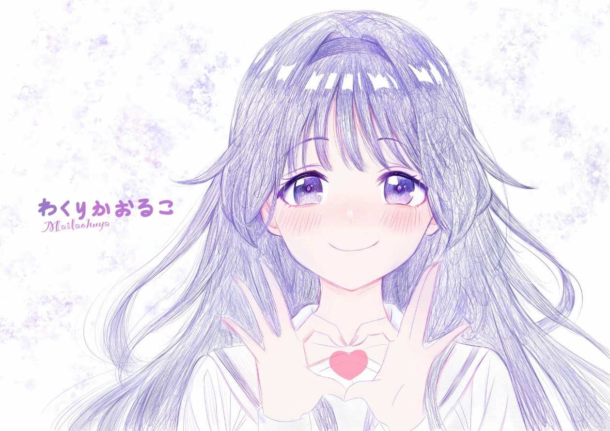

<div align="center">

# 🌸 dsh-startup-animation

**DeepSeek Harness の起動アニメーション + ホーム画面の壁紙**

*ソフトを開くその2秒も、ちょっと素敵にできますにゃ。*



</div>

**[简体中文](README.md)** | **[English](README.en.md)** | **[日本語](README.ja.md)** | **[한국어](README.ko.md)**

---

## ✨ どんな演出をするの

一度の起動で、ちょっとした小芝居を一幕演じます 🎬

| タイミング | 画面 |
| --- | --- |
| `0.0s` | ホーム画面は `<head>` 内の早期スクリプトで先に隠されるので、**白いホーム画面が一瞬ちらつくことはありません** |
| `~0.1s` | 背景がゆっくり寄る · オーロラが行き来する · 星屑がきらめく · 光の粒が上へ漂う · 流星がときどき流れる |
| `~0.2s` | アバターが「ポン」と弾みながら登場。一瞬強く光るリング + 周囲に飛び散る火花 + 2つの波紋、さらにガラスのような反射が一瞬走ります |
| `~0.3s` | 「**おかえりなさい**」が一文字ずつ浮かび上がり、下からグラデーションの細い線が伸びます |
| 全体 | 2つのローディングリングが逆方向にゆっくり回転 · アバターがごくゆっくり寄る · マウスを動かすと画面全体が奥行きに応じて**レイヤーごとに視差**で揺れ、アバターも3Dでかすかに傾き、暖かい光がポインターを追いかけます 🐾 |
| 読み込み完了 | 背景が「レンズに収まる」ように、寄った状態から1:1へ戻り（目に見える一瞬）、起動画面のレイヤー全体がフェードアウト。**ホーム画面の各モジュールがパズルのように組み上がります** 🧩 |
| ホーム画面へ | ホーム画面の壁紙は**同じ背景画像**なので、背景がぼんやりからくっきりへ変わるような、自然なつながりに見えます 🍃 |

最短1.5秒、最長5秒の演出です。**クリックするか任意のキーを押す**とスキップできます。

上の演出には**3つの画質モード**（省電力 / 標準 / 豪華、デフォルトは標準）と、**日付に合わせて自動で変わる季節のイースターエッグ**（桜シーズン、雪、新年、誕生日）があります —— すべて設定で変更可能です。詳しくは下の「画質モード」と「季節のイースターエッグ」をご覧ください。

ホーム画面に入ったあとにも、もうひとつ変更があります。新規セッションのタイトル行から**左側のクジラのロゴと右側の「プレビュー版」バッジを外し**、「未踏の領域を探索」を自分で書いた挨拶文に置き換えて、**一文字ずつタイプ表示**します。末尾には点滅する入力カーソルが付き、誰かが話しかけてくれているような雰囲気になります（デフォルトは「こんにちは、和栗薫子です。Deepseek Harness へようこそ」）。

挨拶文、速度、カーソル、2つの非表示スイッチは**すべて設定で変更でき**、保存するとすぐホーム画面に反映されます。再読み込みは不要です 👇

さらに —— **2枚の画像、画質モード、季節のイースターエッグ、ホーム画面のタイトルはすべて設定で自由に変更でき**、その場でプレビューできます。再起動は不要です 👇

## 🎀 設定：起動アニメーションと壁紙

| 場所 | できること |
| --- | --- |
| 上部の「リアルタイムプレビュー」 | 起動時のアニメーションをそのまま小窓で再生します（ホーム画面の壁紙、モード、季節の演出も含み、最後の引き継ぎまで確認できます）。画像/モード/季節/文言を変えると**自動で再生し直し**、「リプレイ」で手動再生、「新しいタブで開く」で拡大表示できます |
| 起動アニメーション効果カード | **画質モード**（省電力 / 標準 / 豪華）、**アニメーションを強制再生**、**季節のイースターエッグ**（日付に追従 / オフ / 手動指定 + 誕生日 MM-DD）。カードには今日どの演出が行われるかが直接表示されます |
| ホーム画面タイトルカード | 挨拶文、タイプライターのオン/オフ、文字ごとの間隔（10～1000ms）、点滅カーソルとその文字、**ロゴを隠す / 「プレビュー版」バッジを隠す**。保存するとすぐ反映され、タイトルはその場で打ち直されます |
| アバターカード | 起動アニメーションの中央にいるあの子です。「画像を選択」をクリックするか、**画像をカードへ直接ドラッグ＆ドロップ**。角丸の四角で表示するので、猫耳が切り取られることはありません 🐱 |
| 背景画像カード | 起動背景 + ホーム画面の壁紙。横長画像を推奨。画面内では cover で全面に表示されます |
| 初期設定に戻す | カスタム画像を削除し、同梱の画像に戻します。2つの設定カードにある「初期設定に戻す」は、デフォルトのモード / デフォルトの挨拶文に戻します |
| 実際の画面で見てみる | 「いま見た」フラグを消して再読み込みし、DSH の中で本当に再生し直します |

- **PNG / JPEG / WebP / GIF** に対応。1枚あたり**12MB**まで（ファイルのマジックバイトで判定し、Content-Type は見ません）
- カスタム画像とすべての設定は `$DSH_HOME/dsh-startup-animation/`（画像 + `config.json`）に保存されます。ファイルを削除するか「初期設定に戻す」で元に戻せます
- 壁紙、タイトル、モードは**保存するとすぐ反映**。起動アニメーション本体の画面は次回再生時に反映されます（**再読み込みして再生し直すのが一番早い**）。プレビュー小窓で見ても、実際のページが「もう再生した」と勘違いすることは**ありません**

### 🎚 画質モード：省電力 / 標準 / 豪華

| モード | 描かれるもの |
| --- | --- |
| **省電力** | 星屑8、光の粒なし、オーロラの漂いなし、**ポインター視差と追従する暖かい光は完全にオフ**（ポインターに追従するレイヤーが最もフィルレートを食う項目です）。内蔵GPU / 旧式マシンに最適 |
| **標準**（デフォルト） | 星屑16 / 光の粒10 / 火花8 —— 下の「なぜ重くならないの？」で紹介する旧式マシン向けに調整済みの画面と**1ピクセルも変わりません** |
| **豪華** | 星屑30 / 光の粒16 / 火花12。さらに全画面ぼかし、オーロラの拡大縮小、ビネットの呼吸、アバター内部の寄り、2層目の光の輪を復活させます |

**アニメーションを強制再生**は、この設定からの逃げ道です。システムで「視差効果を減らす」がオンになっていると（Windows の「アクセシビリティ → 視覚効果 → アニメーション効果」をオフにするとこうなります）、星屑、オーロラの漂い、ポインター視差は本来すべてオフになります。これにチェックを入れるとあなたの意思が優先され、そのまま再生されます。

### 🎏 季節のイースターエッグ

日付に合わせて配色とパーティクルが自動で変わります。手動で指定することもできます（今すぐ見たいときにどうぞ）：**桜シーズン** 3/20～4/20（ピンクの桜配色 + 揺れながら舞い落ちる**花びら**。この期間は丸い光の粒を出しません）、**雪** 12/1～2/15（寒色系 + 冷たい縁取りの雪。明るい壁紙でも見えます）、**新年** 1/1～1/3（金と赤の配色、挨拶文が「あけましておめでとう」に）、**誕生日**（ピンクと紫の配色 + カラフルな紙吹雪、挨拶文が「お誕生日おめでとう」に）。見たくないときは季節の演出を「オフ」にしてください。

- **手動で選ぶ = 今すぐその演出を再生**（「誕生日」を選ぶのに日付入力は不要）。誕生日の日付は「日付に追従」モード専用です
- 誕生日の書き方はとても自由：`02-14`、`2-14`、`2/14`、`2.14`、`2月14日`、`0214`、`2026-12-24` をすべて認識し、保存後は `02-14` に統一表示されます。どうしても理解できない場合は**はっきり知らせてくれます**し、黙って捨てることはありません
- 効果を確認する最短ルート：保存後にカードの「**今すぐ再生し直す**」をクリック。通常の再読み込みでは60秒以内ならアニメーション全体がスキップされ、保存時にプラグインがそのフラグを消してくれます

> 季節の演出は配色とパーティクルだけを変え、**背景レイヤーと白いベールには絶対に触れません** —— 最後の3つの位置合わせのうち2つは背景と引き継ぎレイヤーに依存しているので、変えるとトランジションが飛んでしまいます。

## 🚀 インストール

> 🖥 **DeepSeek 公式デスクトップ版をお使いですか？ [`official-desktop` ブランチ](https://github.com/KylinQ01/dsh-startup-animation/tree/official-desktop) をインストールしてください**
> （`git clone -b official-desktop https://github.com/KylinQ01/dsh-startup-animation.git`）。
> 公式デスクトップ版では `index.html` を Electron シェルがパッケージ済み dist から直接出力するため、`webServer.tapIndex`
> は決して実行されません —— この `main` ブランチを入れても**起動アニメーションと壁紙は表示されません**（設定ページは正常に動きます）。
> 症状・根本原因・修正方法は [`DESKTOP-FIX.md`](https://github.com/KylinQ01/dsh-startup-animation/blob/official-desktop/DESKTOP-FIX.md) をご覧ください。

```powershell
git clone https://github.com/KylinQ01/dsh-startup-animation.git
```

次に、依存関係を profile の `package.json` に書き込みます（`link:` は先ほど clone したディレクトリを指します）：

```jsonc
// ~/.dsh/profiles/<profile>/package.json
"dependencies": {
  "dsh-startup-animation": "link:/絶対パス/dsh-startup-animation"
}
```

```powershell
dsh plugin --profile desktop install --offline   # node_modules のリンクを作成し、dsh.profile.bundles に自動で追加します
dsh --profile desktop --dump-config | Select-String startup-animation   # id: dsh-startup-animation が見えれば正解です
```

その後、**DSH を再起動**します（DSH Desktop または `dsh web`）。ホストのログに次が表示されます：

```
[dsh-startup-animation] dsh-startup-animation: 起動アニメーション + ホーム画面の壁紙をマウントしました、画像ディレクトリ …
```

> ⚠️ Windows でパスにスペースが含まれる場合、**`dsh plugin add` にパスを渡さないでください** —— cmd 経由で転送される際に引数が分割されてしまいます。
> 手動で `package.json` に書き込み、`install` を実行してください。

**アンインストール**：profile の `package.json` から依存関係を削除し、もう一度 `dsh plugin install` を実行すると、`bundles` は自動的に整理されます。
（プラグインディレクトリは削除したり名前を変更したりしないでください —— profile が `link:` で指しています。）

## 🎛 自分でカスタマイズしたい

| 変えたいもの | 変える場所 |
| --- | --- |
| テンポ：最短/フォールバック時間、準備完了判定、トランジション時間、星屑と光の粒の数 | `assets/boot.js` 冒頭の定数（`SPARKS` は入場時の火花の数） |
| アバターのサイズと角丸、文字、プログレスバー | `assets/boot.css` の `.dshs-avatar` / `.dshs-hello` / `.dshs-bar` |
| 背景の寄る速さと量 | `.dshs-bg` の `transform: scale(...)` 2箇所（入場値 / is-in 値）と 26s という時間 |
| **オーロラの色と濃さ** | `.dshs-aurora i:nth-child(1~2)` の2組の `radial-gradient` |
| 星屑 / 光の粒 / 流星 | `.dshs-star` / `.dshs-petal` / `.dshs-streaks` |
| **2つのローディングリング** | `.dshs-orbit`（大きさ、太さ、回転速度、色はすべてここ。2つ目のリングは `.dshs-orbit + .dshs-orbit`） |
| **ポインターを追う暖かい光** | `.dshs-cursor` の `radial-gradient` と `translate` 内の `50vw/50vh` |
| **アバターの3D傾き量** | `.dshs-portrait` の `rotateY/rotateX` にある2つの `6deg/5deg` |
| **マウス視差の量** | `boot.css` 冒頭の3行の `translate: calc(var(--dshs-px) * Npx)`。この N を変えると奥行きが変わります |
| ホーム画面の壁紙の濃さ / サイドバーの透明度 | `assets/wallpaper.css` の `--dshs-wall-veil-a/b`（大きいほど薄い）と `--dsw-specific-sidebar-fill` |
| **ホーム画面の挨拶文 / タイプライター / カーソル / ロゴとバッジの非表示** | 設定ページの「ホーム画面タイトル」カード（`$DSH_HOME/dsh-startup-animation/config.json` に保存）。hero のアンカーやカーソルアニメーションを変えたい場合は `client/client.js` の `HERO_FROM` と `assets/hero.css` を参照 |
| **画質モード / 強制再生** | 設定ページの「起動アニメーション効果」カード。3モードのパーティクル数は `assets/boot.js` の `COUNTS`、各モードの描画は `assets/boot.css` の `html.dshs-fx-*` |
| **季節のイースターエッグ** | 日付ウィンドウは `lib/index.js` の `autoFestival()`（純粋関数で、固定日付の自己テスト済み）。配色と専用パーティクルは `assets/boot.css` の `html.dshs-fest-*`、パーティクル数は `boot.js` の `FESTIVAL` の行 |

## 🪶 なぜ重くならないの？（低スペック機にやさしい）

デフォルトモード（＝「標準」）は**「旧式マシン / 内蔵GPU」に合わせて調整**されています。同じ画面で、フレーム間隔の中央値が50msから33msに低下
（ソフトウェアレンダリングでの実測、フレーム数は倍、p90は117msから50msに）。やり方は**「毎フレーム再描画」系のコストを削り、
「純粋な合成」系のアニメーションはすべて残す**こと —— 前者はフィルレートを食い、後者はほぼタダです：

| 削ったもの | なぜ |
| --- | --- |
| 背景の `filter: blur(6px)` | 全画面ぼかしで、しかも背景が拡大縮小しながらフィルターもかかる = 毎フレーム全画面を再計算。白いベール + ビネットで「遠ざかる」感じを出します |
| 回転する光線（conic + `mask-image`） | 1レイヤーだけで132vmax（≈2500×2500px）、さらにマスク合成 + 回転が重なり、全体で最も高価な項目 |
| オーロラの `scale` アニメーション | 柔らかい光を拡大縮小するたびに、新しいサイズでレイヤー全体を再ラスタライズする必要がありました。今は平行移動のみ |
| アバター内部の `scale(1.09→1)` | `overflow:hidden` + 角丸の中で画像を拡大縮小すると、毎フレーム再クロップされます |
| ビネットの「呼吸」 | 全画面の不透明度アニメーション = 再生時間中ずっと全画面ピクセルを合成 |
| 星屑 30→16、光の粒 16→10、火花 12→8、影を1層削除 | 要素と影の数は直接描画量になります |
| 壁紙の `background-attachment: fixed` | このアプリにはページ全体のスクロールがないので、fixed でもそうでなくても見た目は同じ。ただし fixed はより遅い合成パスを通ります |

> ホーム画面の「モジュール組み立て」は性能を**犠牲にしていません**。以前は「`#root` 全体を一度フェードイン」でしたが、
> 今は「いくつかのモジュールがそれぞれフェードイン」——総ピクセル数はほぼ同じで、いくつかの塊に分かれただけなのに、見た目は格段に良くなります。

**フル装備に戻したい場合**：もうソースを書き換える必要はありません —— 設定で画質モードを「**豪華**」に切り替えれば、
上の表にある全画面ぼかし、オーロラの拡大縮小、ビネットの呼吸、アバターの寄り、パーティクル増加がすべて戻ります（省電力モードはさらに1段削ります）。
`node check.mjs` が2つのルールを守ります：デフォルトモードで `.dshs-bg` の `filter` を出してはいけない、豪華モードの背景ぼかしは
**最後に必ずゼロへ戻る**（そうでないとホーム画面の壁紙と合いません）。あの回転する光線は今もありません。全体で最も高価な項目で、
2.1 で意図的に削除されたものです。

`lib/index.js`（ルーティング、注入）を変更したらホストの再起動が必要です。`client/client.js` だけならクライアントの HMR でホット更新されます。

**トランジションは「700ms のタイムライン1本」**：`boot.css` の `#dshs.is-out` の `opacity .7s` は
`boot.js` の `OUT_MS = 700` と一致している必要があります。そうでないと起動画面が早く消えたり、尾を引いたりします。

**ホーム画面の「モジュール組み立て」はどうやってモジュールを選ぶのか**：`boot.js` の `assemble()` は**幾何学的なサイズ**で選び、クラス名は見ません ——
まず「最初の階層に十分大きい子が2つ以上ある」階層を探し（大きい子が1つだけならまだ外殻に包まれているので、もう1階層深くへ）、
次に最大の塊から「幅広で扁平な」子モジュール（ツールバー、入力エリア）を加え、最大6個までにします。
しきい値は `big()` / `medium()` の2つのパーセント、移動量/ずらし/時間は `ASSEMBLE_MS`、`ASSEMBLE_STEP`、
`ASSEMBLE_DELAY`。**フロントエンドの構造が変わっても壊れません**が、どこかが動かない場合は、まずサイズのしきい値を満たしているか確認してください。

**トランジション中に `transition-delay` を追加しないでください。`will-change` も追加しないでください**：このときホーム画面は初回レンダリング中で、
メインスレッドが忙しいと、メインスレッド上の `opacity` トランジションはコンポジター上の移動より遅れて始まります。遅延はズレを広げるだけで、
これほど大きな合成レイヤーに `will-change: opacity` を付けると遅くなるだけです。（実測で痛い目を見た知見です。）

**最後が「飛ばない」のは3箇所の位置合わせのおかげ**です。どれか1つを触るなら3箇所すべてを確認してください：

1. 起動画面の背景 `.dshs-bg` は inset の余白を持たず、`object-fit: cover` の構図＝ホーム画面壁紙の `center/cover`。
2. 最後に `.dshs-bg` は `scale(1)` + ぼかし解除 + 視差ゼロへ（**transition で戻すこと。animation はダメ**：
   animation が外れた瞬間に目標値へ飛び、その一瞬が見えなくなります）。
3. `.dshs-handoff` は壁紙と同じ白いベール変数で白さを揃える（そうでないと画像は合っても白さが合わず、やはり一瞬光ります）。

**ノードを外すタイミングを固定値にしてはいけません**：`boot.js` は `transitionend`（opacity の完了）を待ってから起動画面を外し、
タイマーはフォールバックだけです。固定の `OUT_MS + 120` にすると、メインスレッドが詰まったときにまだフェード中の起動画面を強制カットしてしまい ——
「トランジションがない」ように見えます。

> `check.mjs` は **boot.js で使われているクラス名に boot.css のルールがあるか**を1つずつ確認し（新しい画面レイヤーで書き忘れると即エラー）、
> 上記3箇所の位置合わせが壊れていないかもチェックします 🔍

## 🧪 セルフチェック & ローカルプレビュー

```powershell
node check.mjs      # Node 18+
```

ルーティング、注入ポイント、冪等性、スクリプト構文、アップロード/ロールバックの往復全体、設定ページのコンポーネントを一通り実行し、
最後に `preview/index.html` を生成します —— **ダブルクリックするだけでアニメーションとトランジションを完全に確認でき**、DSH に入れる必要はありません。

> 💡 ヘッドレスブラウザでスクリーンショットを撮って画面を確認する場合の注意：headless Chromium はデフォルトで `prefers-reduced-motion` を `reduce` と報告するため、
> 星屑/光の粒/ループアニメーションがオフになり、見えるのは「ミュート版」です。CDP の `Emulation.setEmulatedMedia` で明示的に
> `no-preference` をシミュレートすると、実際の効果になります。

## ❓ よくある小さな疑問

**ページを再読み込みしてもアニメーションが出ないのはなぜですか？**
同じタブで**60秒以内**に繰り返し再読み込みすると自動でスキップされます（自動リロードのループで毎回演出する必要はありません）。壁紙の変化だけを見てください。
見たいときは、設定の「実際の画面で見てみる」をクリックするか、シークレットウィンドウを開いてください。

**ダークテーマに切り替えると壁紙がなくなるのはなぜですか？**
意図的です。明るい画像に明るい文字だと全体がぼやけてしまうので、ダークテーマはそのままにしています。どうしても欲しい場合は、
`wallpaper.css` の `:not([data-ds-dark-theme])` を削除し、そのうえで文字のコントラストをどうするか自分で考えてください 🙈

**白画面になったりしませんか？**
なりません。どのステップで例外が起きても、すぐに起動画面を外してホーム画面を出します —— 最悪でも「アニメーションがない」だけで、
「開かない」ことは絶対にありません。さらに `<head>` には8秒で自動解放する保険も入っています。

**システムで「視差効果を減らす」がオンになっていたらどうなりますか？**
「ずっと動き続ける」ものと「人について動く」ものは**すべてオフ**にします：星屑 / 光の粒 / 雪 / 紙吹雪 / 流星、オーロラの漂い、柔らかい光の呼吸、
ローディングリングの回転、アバターの浮遊、ガラスの反射、ポインター視差と3D傾き、背景の寄り。
**残す**のは一度きりの入場：モジュールの組み立て（移動量は自動で35%に）と起動画面のフェードアウト。
理由は、この設定が対象とするのが大きな移動、視差、連続回転など不快感を招きやすい動きであり、「入場にアニメーションを付けてはいけない」わけではないからです。
以前は一律で全部オフにした結果、Windows のアニメーションを切っているマシンでは**何も見えない**状態になりました（`prefers-reduced-motion` が読むのはまさにそのスイッチです）。

> この設定に縛られたくない場合は、設定の「**アニメーションを強制再生**」にチェックを入れてください —— `<html>` に `dshs-force-motion` が付き、
> CSS の `@media (prefers-reduced-motion: reduce)` ブロック全体がスキップされ、ホーム画面のカーソルも点滅し続けます。
> （`boot.js` は「動きを許可するかどうか」を `html.dshs-motion` という1つのクラスに集約しています。豪華モードの常駐ループはその下にぶら下がっており、
> そうしないと豪華モードのセレクタの方が優先度が高く、reduce ブロックを押しのけて「視差効果を減らす」マシンでも拡大縮小してしまいます。）
>
> 逆に、Windows の「アクセシビリティ → 視覚効果 → アニメーション効果」がオフの場合、このプラグインはデフォルトで上記の簡略パスだけを通ります。
> システムのスイッチをオンにするか、上記の「アニメーションを強制再生」を使ってください。

## 📄 ライセンス

[MIT](LICENSE) © KylinQ01

<div align="center">

*あなたが開くたびに、あたたかく迎えられますように。* 🌙

</div>
