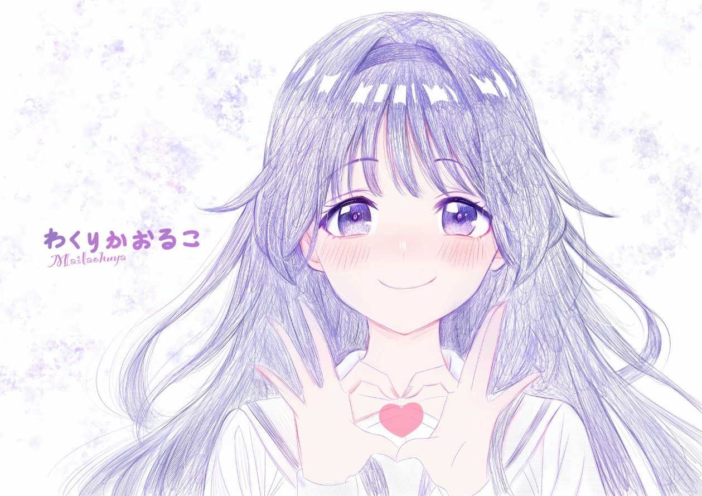

<div align="center">

# 🌸 dsh-startup-animation

**DeepSeek Harness용 시작 애니메이션 + 홈 화면 배경**

*앱을 여는 그 2초도 충분히 예쁠 수 있답니다. 냥!*



</div>

**[简体中文](README.md)** | **[English](README.en.md)** | **[日本語](README.ja.md)** | **[한국어](README.ko.md)**

---

## ✨ 무엇을 하나요

한 번 켤 때마다 작은 연출 한 편을 보여 줍니다 🎬

| 순간 | 화면 |
| --- | --- |
| `0.0s` | 홈 화면은 `<head>`의 초기 스크립트가 미리 숨겨 두므로 **흰 홈 화면이 먼저 번쩍이지 않습니다** |
| `~0.1s` | 배경이 천천히 다가오고 · 오로라가 오가고 · 별가루가 반짝이고 · 빛 입자가 위로 떠오르고 · 유성이 가끔 스쳐 지나갑니다 |
| `~0.2s` | 아바타가 '폴짝' 튀어 들어오며 번쩍이는 링 + 사방으로 튀는 불꽃 + 두 겹의 물결, 그리고 유리 같은 반사가 한 번 훑고 지나갑니다 |
| `~0.3s` | '**다시 오신 것을 환영합니다**'가 한 글자씩 떠오르고, 아래에서 그라데이션으로 된 얇은 선이 펼쳐집니다 |
| 전체 | 두 개의 로딩 링이 서로 반대 방향으로 천천히 회전 · 아바타가 아주 천천히 다가옴 · 마우스를 움직이면 화면 전체가 원근에 따라 **레이어별 시차**로 흔들리고, 아바타도 살짝 3D로 기울며, 따뜻한 빛이 포인터를 따라갑니다 🐾 |
| 로딩 완료 | 배경이 '렌즈에 담기듯' 다가온 상태에서 1:1로 돌아오고(눈에 보이는 한 박자), 시작 화면 레이어 전체가 페이드 아웃됩니다. **홈 화면의 모듈들이 퍼즐처럼 하나씩 조립됩니다** 🧩 |
| 홈 화면 진입 | 홈 화면 배경은 **바로 같은 배경 이미지**라서, 배경이 흐릿함에서 선명함으로 바뀌는 듯한 자연스러운 연결로 보입니다 🍃 |

가장 짧게는 1.5초, 길게는 5초까지 보여 줍니다. **한 번 클릭하거나 아무 키나 누르면** 건너뛸 수 있습니다.

위 연출에는 **세 가지 화질 모드**(절전 / 표준 / 화려, 기본값은 표준)와 **날짜에 따라 자동으로 바뀌는 계절 이스터 에그**(벚꽃 시즌, 눈, 새해, 생일)가 있습니다 —— 모두 설정에서 바꿀 수 있으며, 자세한 내용은 아래의 「화질 모드」와 「계절 이스터 에그」를 참고하세요.

홈 화면에 들어간 뒤에도 바뀌는 부분이 하나 더 있습니다. 새 세션 제목 줄에서 **왼쪽의 고래 로고와 오른쪽의 '프리뷰 버전' 배지를 없애고**, '미지의 영역 탐험'을 직접 쓴 인사말로 바꾼 뒤 **한 글자씩 타자기처럼 출력**합니다. 끝에는 깜빡이는 입력 커서가 따라붙어 누군가 말을 걸어오는 듯한 느낌을 줍니다(기본값은 '안녕하세요, 와쿠리 카오루코입니다. Deepseek Harness에 오신 것을 환영합니다').

문구, 속도, 커서, 두 가지 숨기기 스위치는 **모두 설정에서 바꿀 수 있고**, 저장하면 새로고침 없이 홈 화면에 바로 적용됩니다 👇

게다가 —— **두 이미지, 화질 모드, 계절 이스터 에그, 홈 화면 제목을 모두 설정에서 직접 바꿀 수 있고**, 바꾼 즉시 미리 볼 수 있으며 재시작도 필요 없습니다 👇

## 🎀 설정: 시작 애니메이션과 배경

| 위치 | 하는 일 |
| --- | --- |
| 상단의 '실시간 미리보기' | 시작 애니메이션을 그대로 작은 창에서 재생합니다(홈 화면 배경, 모드, 계절 연출까지 포함하고 마지막 핸드오프도 볼 수 있습니다). 이미지/모드/계절/문구를 바꾸면 **자동으로 다시 재생**되고, '다시 재생'은 수동 재생, '새 탭에서 열기'는 크게 봅니다 |
| 시작 애니메이션 효과 카드 | **화질 모드**(절전 / 표준 / 화려), **애니메이션 강제 재생**, **계절 이스터 에그**(날짜 따르기 / 끄기 / 직접 지정 + 생일 MM-DD). 카드에 오늘 어떤 연출이 펼쳐지는지 바로 적혀 있습니다 |
| 홈 화면 제목 카드 | 인사말 문구, 타자기 켜기/끄기, 글자당 간격(10~1000ms), 깜빡이는 커서와 그 문자, **로고 숨기기 / '프리뷰 버전' 배지 숨기기**. 저장하면 즉시 적용되고 제목이 그 자리에서 다시 타이핑됩니다 |
| 아바타 카드 | 시작 애니메이션 한가운데의 그 아바타입니다. '이미지 선택'을 누르거나 **이미지를 카드 위로 바로 끌어다 놓으세요**. 둥근 사각형으로 표시하므로 고양이 귀가 잘리지 않습니다 🐱 |
| 배경 이미지 카드 | 시작 배경 + 홈 화면 배경. 가로 이미지를 권장하며, 화면에서는 cover로 꽉 채웁니다 |
| 기본값 복원 | 사용자 지정 이미지를 삭제하고 플러그인에 포함된 이미지로 돌아갑니다. 두 설정 카드의 '기본값 복원'은 기본 모드 / 기본 인사말로 돌아갑니다 |
| 실제 화면에서 보기 | '방금 봤음' 표시를 지우고 새로고침하여 DSH 안에서 실제로 다시 재생합니다 |

- **PNG / JPEG / WebP / GIF** 지원, 파일당 최대 **12MB**(파일 매직 바이트로 판별하며 Content-Type은 보지 않습니다)
- 사용자 지정 이미지와 모든 설정은 `$DSH_HOME/dsh-startup-animation/`(이미지 + `config.json`)에 저장됩니다. 파일을 삭제하거나 '기본값 복원'을 누르면 되돌릴 수 있습니다
- 배경, 제목, 모드는 **저장 즉시 적용**됩니다. 시작 애니메이션 자체의 화면은 다음 재생 때 적용되며(**새로고침해서 다시 재생하는 것이 가장 빠릅니다**), 미리보기 창에서 봐도 실제 페이지가 '이미 재생했다'고 착각하게 만들지 **않습니다**

### 🎚 화질 모드: 절전 / 표준 / 화려

| 모드 | 그리는 것 |
| --- | --- |
| **절전** | 별가루 8, 빛 입자 없음, 오로라 이동 없음, **포인터 시차와 따라오는 따뜻한 빛은 완전히 끕니다**(포인터를 따라가는 레이어가 필레이트를 가장 많이 잡아먹는 항목입니다). 내장 GPU / 오래된 PC에 최적 |
| **표준**(기본) | 별가루 16 / 빛 입자 10 / 불꽃 8 —— 아래 '왜 렉이 걸리지 않나요?'에 나오는, 오래된 PC에 맞춰 조정된 화면과 **단 1픽셀도 다르지 않습니다** |
| **화려** | 별가루 30 / 빛 입자 16 / 불꽃 12. 여기에 전체 화면 블러, 오로라 확대/축소, 비네트 호흡, 아바타 내부 줌, 두 번째 광채 레이어를 되살립니다 |

**애니메이션 강제 재생**은 이 설정에서 빠져나갈 수 있는 탈출구입니다. 시스템에서 '동작 줄이기'가 켜져 있으면(Windows의 '접근성 → 시각 효과 → 애니메이션 효과'를 끄면 이렇게 됩니다) 별가루, 오로라 이동, 포인터 시차가 원래 모두 꺼집니다. 이 항목을 체크하면 사용자의 선택이 우선되어 그대로 재생됩니다.

### 🎏 계절 이스터 에그

날짜에 따라 색상과 파티클이 자동으로 바뀌며, 직접 지정할 수도 있습니다(지금 바로 보고 싶다면 하나를 고르세요): **벚꽃 시즌** 3/20~4/20(분홍 벚꽃 색감 + 흔들리며 떨어지는 **꽃잎**, 이때는 둥근 빛 입자를 뿌리지 않습니다), **눈** 12/1~2/15(차가운 색조 + 차가운 테두리의 눈, 밝은 배경에서도 보입니다), **새해** 1/1~1/3(금색과 빨간색 배색, 인사말이 '새해 복 많이 받으세요'로 변경), **생일**(분홍·보라 배색 + 알록달록한 색종이 조각, 인사말이 '생일 축하합니다'로 변경). 보고 싶지 않으면 계절 연출을 '끄기'로 설정하세요.

- **직접 하나를 고르면 = 지금 즉시 그 연출을 재생**('생일'을 고를 때 날짜를 먼저 입력할 필요가 없습니다). 생일 날짜는 '날짜 따르기' 모드에만 쓰입니다
- 생일 표기는 아주 자유롭습니다: `02-14`, `2-14`, `2/14`, `2.14`, `2月14日`, `0214`, `2026-12-24`를 모두 인식하고, 저장 후에는 `02-14`로 통일해 표시합니다. 정말 해석할 수 없으면 **분명히 알려 주며**, 조용히 버리지 않습니다
- 효과를 가장 빨리 확인하는 방법: 저장 후 카드의 '**지금 다시 재생**'을 누르세요. 일반 새로고침은 60초 이내에 애니메이션 전체를 건너뛰는데, 저장할 때 플러그인이 그 표시를 지워 줍니다

> 계절 연출은 색상과 파티클만 바꾸며 **배경 레이어와 흰 베일은 절대 건드리지 않습니다** —— 마지막 세 가지 정렬 중 두 가지가 배경과 핸드오프 레이어에 걸려 있어서, 바꾸면 전환이 튀게 됩니다.

## 🚀 설치

> 🖥 **DeepSeek 공식 데스크톱 앱을 사용하시나요? [`official-desktop` 브랜치](https://github.com/KylinQ01/dsh-startup-animation/tree/official-desktop)를 설치하세요**
> (`git clone -b official-desktop https://github.com/KylinQ01/dsh-startup-animation.git`).
> 공식 데스크톱 앱에서는 `index.html`을 Electron 셸이 패키징된 dist에서 직접 내보내므로 `webServer.tapIndex`는
> 절대 실행되지 않습니다 —— 이 `main` 브랜치를 설치해도 **시작 애니메이션과 배경이 나오지 않습니다**(설정 페이지는 정상 동작합니다).
> 증상, 근본 원인, 해결 방법은 [`DESKTOP-FIX.md`](https://github.com/KylinQ01/dsh-startup-animation/blob/official-desktop/DESKTOP-FIX.md)를 참고하세요.

```powershell
git clone https://github.com/KylinQ01/dsh-startup-animation.git
```

그런 다음 의존성을 profile의 `package.json`에 추가합니다(`link:`는 방금 clone한 디렉터리를 가리킵니다):

```jsonc
// ~/.dsh/profiles/<profile>/package.json
"dependencies": {
  "dsh-startup-animation": "link:/절대경로/dsh-startup-animation"
}
```

```powershell
dsh plugin --profile desktop install --offline   # node_modules 링크를 만들고 dsh.profile.bundles에 자동으로 추가합니다
dsh --profile desktop --dump-config | Select-String startup-animation   # id: dsh-startup-animation이 보이면 정상입니다
```

그다음 **DSH를 재시작**하세요(DSH Desktop 또는 `dsh web`). 호스트 로그에 다음이 나타납니다:

```
[dsh-startup-animation] dsh-startup-animation: 시작 애니메이션 + 홈 화면 배경이 마운트되었습니다. 이미지 디렉터리 …
```

> ⚠️ Windows에서 경로에 공백이 있으면 **`dsh plugin add`에 경로를 넘기지 마세요** —— cmd를 거쳐 전달되면서 인자가 잘게 쪼개집니다.
> `package.json`에 직접 적고 `install`을 실행하면 됩니다.

**제거**: profile의 `package.json`에서 의존성을 삭제한 뒤 `dsh plugin install`을 다시 실행하면 `bundles`가 자동으로 정리됩니다.
(플러그인 디렉터리는 삭제하거나 이름을 바꾸지 마세요 —— profile이 `link:`로 가리키고 있습니다.)

## 🎛 직접 바꾸고 싶다면

| 바꾸고 싶은 것 | 바꿀 곳 |
| --- | --- |
| 속도: 최소/최대 대기 시간, 준비 판정, 전환 시간, 별가루·빛 입자 수 | `assets/boot.js` 맨 위의 상수들(`SPARKS`는 입장 불꽃 수) |
| 아바타 크기·모서리 반경, 텍스트, 진행 표시줄 | `assets/boot.css`의 `.dshs-avatar` / `.dshs-hello` / `.dshs-bar` |
| 배경이 다가오는 속도와 정도 | `.dshs-bg`의 `transform: scale(...)` 두 곳(입장 값 / is-in 값)과 26s라는 시간 |
| **오로라 색상과 농도** | `.dshs-aurora i:nth-child(1~2)`의 두 `radial-gradient` 묶음 |
| 별가루 / 빛 입자 / 유성 | `.dshs-star` / `.dshs-petal` / `.dshs-streaks` |
| **두 개의 로딩 링** | `.dshs-orbit`(크기, 두께, 회전 속도, 색상은 모두 여기에 있습니다. 두 번째 링은 `.dshs-orbit + .dshs-orbit`) |
| **포인터를 따라오는 따뜻한 빛** | `.dshs-cursor`의 `radial-gradient`와 `translate` 안의 `50vw/50vh` |
| **아바타 3D 기울기 정도** | `.dshs-portrait`의 `rotateY/rotateX`에 있는 두 `6deg/5deg` |
| **마우스 시차 정도** | `boot.css` 맨 위의 `translate: calc(var(--dshs-px) * Npx)` 세 줄. 이 N을 바꾸면 깊이가 달라집니다 |
| 홈 화면 배경 농도 / 사이드바 투명도 | `assets/wallpaper.css`의 `--dshs-wall-veil-a/b`(클수록 더 옅음)와 `--dsw-specific-sidebar-fill` |
| **홈 화면 인사말 / 타자기 / 커서 / 로고와 배지 제거** | 설정 페이지의 '홈 화면 제목' 카드(`$DSH_HOME/dsh-startup-animation/config.json`에 저장). hero 앵커나 커서 애니메이션을 바꾸려면 `client/client.js`의 `HERO_FROM`과 `assets/hero.css`를 참고 |
| **화질 모드 / 강제 재생** | 설정 페이지의 '시작 애니메이션 효과' 카드. 세 모드의 파티클 수는 `assets/boot.js`의 `COUNTS`, 각 모드의 그리기는 `assets/boot.css`의 `html.dshs-fx-*` |
| **계절 이스터 에그** | 날짜 창은 `lib/index.js`의 `autoFestival()`(순수 함수이며 고정 날짜로 자체 테스트 완료). 색상과 전용 파티클은 `assets/boot.css`의 `html.dshs-fest-*`, 파티클 수는 `boot.js`의 `FESTIVAL` 줄 |

## 🪶 왜 렉이 걸리지 않나요? (저사양 PC 친화적)

기본 모드(즉, '표준')는 **'오래된 PC / 내장 GPU'에 맞춰 조정**되었습니다. 같은 화면에서 프레임 간격 중앙값이 50ms에서 33ms로 줄었고
(소프트웨어 렌더링 실측, 프레임 수는 두 배, p90은 117ms에서 50ms로 감소). 방식은 **'매 프레임 다시 그리기'류의 비용을 잘라내고
'순수 합성'류의 애니메이션은 모두 남기는** 것입니다 —— 전자는 필레이트를 먹고, 후자는 거의 공짜입니다:

| 잘라낸 것 | 이유 |
| --- | --- |
| 배경의 `filter: blur(6px)` | 전체 화면 블러에다 배경이 확대/축소되면서 필터까지 걸리므로 매 프레임 화면 전체를 다시 계산합니다. 이제는 흰 베일 + 비네트로 '멀어지는' 느낌을 냅니다 |
| 회전하는 광선(conic + `mask-image`) | 한 레이어만 132vmax(≈2500×2500px)이고 마스크 블렌딩 + 지속 회전까지 겹쳐 전체에서 가장 비싼 항목입니다 |
| 오로라의 `scale` 애니메이션 | 부드러운 빛을 확대/축소할 때마다 새 크기로 레이어 전체를 다시 래스터화해야 했습니다. 이제는 평행 이동만 합니다 |
| 아바타 내부의 `scale(1.09→1)` | `overflow:hidden` + 둥근 모서리 안에서 이미지를 확대/축소하면 매 프레임 다시 잘라냅니다 |
| 비네트의 '호흡' | 전체 화면 불투명도 애니메이션 = 재생 시간 내내 화면 전체 픽셀을 합성 |
| 별가루 30→16, 빛 입자 16→10, 불꽃 12→8, 그림자 한 겹 제거 | 요소와 그림자 수가 곧 그리기 작업량입니다 |
| 배경의 `background-attachment: fixed` | 이 앱에는 전체 페이지 스크롤이 없어 fixed든 아니든 차이가 없지만, fixed는 더 느린 합성 경로를 탑니다 |

> 홈 화면의 '모듈 조립'은 성능을 **희생하지 않았습니다**. 원래는 '`#root` 전체를 한 번 페이드 인'이었지만,
> 이제는 '몇 개의 모듈이 각각 페이드 인'——전체 픽셀 양은 거의 같고 단지 여러 덩어리로 나뉘었을 뿐인데, 보기는 훨씬 좋습니다.

**풀옵션 버전으로 돌아가고 싶다면**: 이제 소스를 수정할 필요가 없습니다 —— 설정에서 화질 모드를 '**화려**'로 바꾸면
위 표의 전체 화면 블러, 오로라 확대/축소, 비네트 호흡, 아바타 줌, 추가 파티클이 모두 돌아옵니다(절전 모드는 한 단계 더 잘라냅니다).
`node check.mjs`가 두 가지 원칙을 지킵니다: 기본 모드에는 `.dshs-bg`의 `filter`가 있으면 안 되고, 화려 모드의 배경 블러는
**마무리 시 반드시 0으로 돌아와야** 합니다(그렇지 않으면 홈 화면 배경과 맞지 않습니다). 그 회전하는 광선은 여전히 없습니다. 전체에서 가장 비싼 항목이며
2.1에서 의도적으로 제거했습니다.

`lib/index.js`(라우팅, 주입)를 바꾸면 호스트를 재시작해야 하고, `client/client.js`만 바꾸면 클라이언트 HMR로 핫 리로드됩니다.

**전환은 '700ms 타임라인 하나'**입니다: `boot.css`의 `#dshs.is-out`에 있는 `opacity .7s`는
`boot.js`의 `OUT_MS = 700`과 일치해야 합니다. 그렇지 않으면 시작 화면이 일찍 사라지거나 꼬리가 남습니다.

**홈 화면 '모듈 조립'은 모듈을 어떻게 고르나요**: `boot.js`의 `assemble()`은 **기하학적 크기**로 고르고 클래스 이름은 보지 않습니다 ——
먼저 '첫 번째 계층에 충분히 큰 자식이 2개 이상 있는' 계층을 찾고(큰 자식이 1개뿐이면 아직 껍데기에 싸여 있으니 한 계층 더 들어갑니다),
다음으로 가장 큰 블록에서 '넓고 납작한' 자식 모듈(툴바, 입력 영역)을 더해 최대 6개까지 만듭니다.
임계값은 `big()` / `medium()`의 두 퍼센트이고, 이동량/스태거/시간은 `ASSEMBLE_MS`, `ASSEMBLE_STEP`,
`ASSEMBLE_DELAY`입니다. **프런트엔드 구조가 바뀌어도 작동은 유지되지만**, 특정 블록이 움직이지 않는다면 먼저 크기 임계값을 통과했는지 확인하세요.

**전환 중에는 `transition-delay`를 넣지 말고 `will-change`도 넣지 마세요**: 이때 홈 화면은 첫 렌더링 중이라
메인 스레드가 바쁘면 메인 스레드의 `opacity` 전환이 컴포지터의 이동보다 늦게 시작됩니다. 지연은 어긋남만 키우고,
이렇게 큰 합성 레이어에 `will-change: opacity`를 걸면 더 느려질 뿐입니다. (실측으로 뼈저리게 배운 내용입니다.)

**마무리가 '튀지 않는' 것은 세 군데 정렬 덕분**입니다. 하나를 건드리면 세 군데를 모두 확인하세요:

1. 시작 화면 배경 `.dshs-bg`에는 inset 여유가 없고, `object-fit: cover`의 구도 = 홈 화면 배경의 `center/cover`입니다.
2. 마무리 시 `.dshs-bg`는 `scale(1)` + 블러 해제 + 시차 0으로 갑니다(**transition으로 되돌리세요. animation은 안 됩니다**:
   animation이 제거되는 순간 목표값으로 튀어서 그 한 프레임이 보이지 않습니다).
3. `.dshs-handoff`는 배경과 같은 흰 베일 변수로 흰 정도를 맞춥니다(그렇지 않으면 이미지는 맞아도 흰 정도가 달라 여전히 번쩍입니다).

**노드를 제거하는 시점을 고정값으로 쓰면 안 됩니다**: `boot.js`는 `transitionend`(opacity 완료)를 기다린 뒤 시작 화면을 제거하고,
타이머는 폴백일 뿐입니다. 고정된 `OUT_MS + 120`으로 쓰면 메인 스레드가 막힐 때 아직 페이드가 끝나지 않은 시작 화면을 강제로 잘라내게 됩니다 ——
'전환이 없다'처럼 보입니다.

> `check.mjs`는 **boot.js에서 쓰는 클래스 이름에 boot.css 규칙이 있는지** 하나씩 확인하고(새 화면 레이어에서 빠뜨리면 즉시 오류),
> 위의 세 가지 정렬이 깨지지 않았는지도 검사합니다 🔍

## 🧪 자체 점검 & 로컬 미리보기

```powershell
node check.mjs      # Node 18+
```

라우팅, 주입 지점, 멱등성, 스크립트 구문, 업로드/롤백의 전체 왕복, 설정 페이지 컴포넌트를 모두 실행하고,
마지막으로 `preview/index.html`을 생성합니다 —— **더블클릭만 하면 애니메이션과 전환을 전부 확인할 수 있고**, DSH에 설치할 필요가 없습니다.

> 💡 헤드리스 브라우저로 스크린샷을 찍어 화면을 확인할 때 주의하세요: headless Chromium은 기본적으로 `prefers-reduced-motion`을 `reduce`로 보고하여
> 별가루/빛 입자/반복 애니메이션을 꺼 버리므로, 보이는 것은 '음소거 버전'입니다. CDP의 `Emulation.setEmulatedMedia`로
> `no-preference`를 명시적으로 시뮬레이션해야 실제 효과가 나옵니다.

## ❓ 작은 질문들

**페이지를 새로고침해도 애니메이션이 나오지 않는 이유는 무엇인가요?**
같은 탭에서 **60초 이내**에 반복 새로고침하면 자동으로 건너뜁니다(자동 새로고침 루프에서 매번 연출할 필요는 없습니다). 배경 변화만 보게 됩니다.
보고 싶다면 설정의 '실제 화면에서 보기'를 누르거나 시크릿 창을 여세요.

**다크 테마로 바꾸면 왜 배경이 없나요?**
의도한 것입니다. 밝은 이미지에 밝은 글자가 겹치면 뭉개지므로 다크 테마는 그대로 둡니다. 정말 원한다면
`wallpaper.css`에서 `:not([data-ds-dark-theme])`를 지우고, 그다음 글자 대비를 어떻게 할지 직접 고민하세요 🙈

**흰 화면이 뜨지는 않나요?**
아닙니다. 어느 단계에서 예외가 발생해도 즉시 시작 화면을 걷어내고 홈 화면을 보여 줍니다 —— 최악의 경우는 '애니메이션 없음'이지
'열리지 않음'은 절대 아닙니다. 또한 `<head>`에 8초 자동 해제 보험도 들어 있습니다.

**시스템에서 '동작 줄이기'를 켜 두면 어떻게 되나요?**
'계속 움직이는' 것과 '사람을 따라 움직이는' 것은 **모두 끕니다**: 별가루 / 빛 입자 / 눈 / 색종이 / 유성, 오로라 이동, 부드러운 빛의 호흡,
로딩 링 회전, 아바타 부유, 유리 반사, 포인터 시차와 3D 기울기, 배경 줌.
**유지하는** 것은 일회성 입장 연출입니다: 모듈 조립(이동량은 자동으로 35%로 축소)과 시작 화면 페이드 아웃.
이 설정은 큰 이동, 시차, 지속 회전처럼 불편함을 유발할 수 있는 동작을 대상으로 하기 때문이며, '입장에는 애니메이션을 넣지 말라'는 뜻은 아닙니다.
예전에는 전부 일괄로 껐는데, Windows 애니메이션을 끈 PC에서는 **아무것도 보이지 않았습니다**(`prefers-reduced-motion`이 읽는 것이 바로 그 스위치입니다).

> 이 설정에 따르고 싶지 않다면 설정에서 '**애니메이션 강제 재생**'을 체크하세요 —— `<html>`에 `dshs-force-motion`이 붙어
> CSS의 `@media (prefers-reduced-motion: reduce)` 블록 전체를 건너뛰고, 홈 화면의 커서까지 계속 깜빡입니다.
> (`boot.js`는 '동작을 허용할지'를 `html.dshs-motion`이라는 클래스 하나로 계산합니다. 화려 모드의 상시 루프가 그 아래에 매달려 있으며,
> 그렇지 않으면 화려 모드 선택자의 우선순위가 더 높아 reduce 블록을 덮어쓰고 '동작 줄이기' PC에서도 계속 확대/축소합니다.)
>
> 반대로 Windows의 '접근성 → 시각 효과 → 애니메이션 효과'가 꺼져 있으면 이 플러그인은 기본적으로 위의 간소화 경로만 사용합니다.
> 시스템 스위치를 켜거나, 위의 '애니메이션 강제 재생'을 사용하세요.

## 📄 라이선스

[MIT](LICENSE) © KylinQ01

<div align="center">

*이 앱을 열 때마다, 제대로 환영받는 기분이 들기를 바랍니다.* 🌙

</div>
